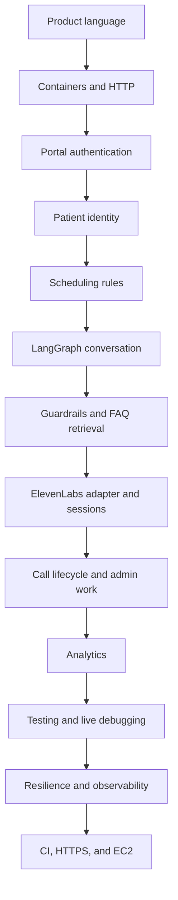
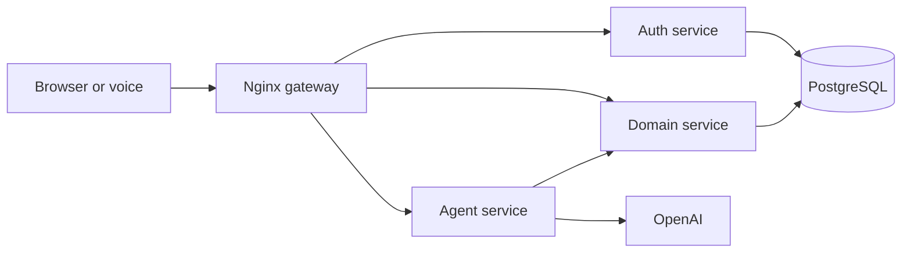
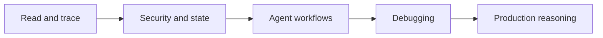
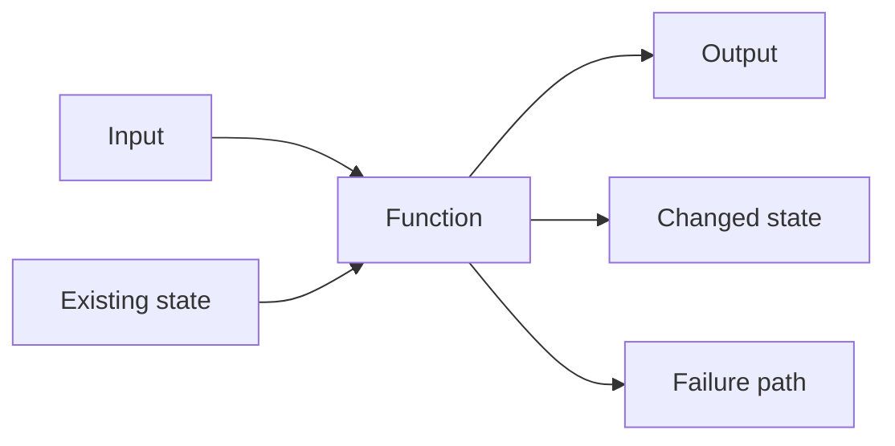
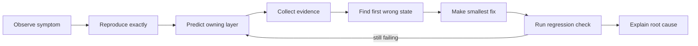

# Voice Agent Codebase Familiarization Workshop

This is a learner-led roadmap for rebuilding the ability to read, write, test, and debug code inside this repository. It assumes no familiarity with the codebase. The goal is not to memorize every file. The goal is to repeatedly follow real values through the system until you can predict what the program will do, find where behavior is owned, make a small change, and prove that the change works.

## What success looks like

By the end of this workshop, you should be able to:

1. Explain the product and draw the six-container architecture from memory.
2. Trace browser, voice, authentication, scheduling, retrieval, and analytics requests through real code.
3. Read an unfamiliar Python or TypeScript function by identifying its input, state changes, output, and failure paths.
4. Write small functions and tests without asking AI to generate the first draft.
5. Reproduce a bug, isolate its owning layer, inspect live evidence, fix it, and verify the fix.
6. Use AI as a reviewer and hint system without surrendering the act of programming.

## Learning path



**How to read it:** Start at product language and move downward. Each arrow means the next topic depends on the previous one. For example, scheduling only makes sense after identity because the scheduling service must know whose Appointment it may change. Do not begin with LangGraph merely because it looks like the most interesting part.

## How to study this guide

Use the same loop in every session:

1. **Retrieve:** Before opening files, say what you remember from the previous lesson.
2. **Predict:** Write down what you think the request or function will do.
3. **Read:** Read only the two to four files named by the lesson.
4. **Trace:** Follow one concrete value in execution order.
5. **Run:** Execute the smallest relevant command.
6. **Notice:** Compare the result with your prediction.
7. **Modify:** Make one small behavioral change or add one focused test.
8. **Debug:** Intentionally trigger one failure and explain the evidence.
9. **Teach back:** Explain the mechanism without looking at the code.

Recommended session length: 45–75 minutes. Stop after one lesson or one debugging problem. Depth is more useful than reading ten files and retaining none.

Local sources: `README.md`, `CONTEXT.md`, `docs/SPEC.md`, `docs/adr/`, `docker-compose.yml`, `gateway/`, `frontend/`, `services/`, `scripts/`, `evals/`, and `.github/workflows/ci.yml`.

---

# Module 1 — The complete code-path map

### Visual model — The major runtime boundaries



**How to read it:** Start at the browser or voice platform and follow arrows in the direction of a request. Nginx selects a service, the Agent delegates business actions to Domain, and all durable application state converges on PostgreSQL.

## The original six core code paths

These are the six end-to-end paths that describe the product's distinctive behavior.

## 1. Path 1 — A complete Maya turn

**Definition:** A complete Maya turn is one caller message moving through transport, routing, reasoning, optional tools, business rules, and response safety.

```shell
Browser or ElevenLabs
  → Nginx gateway
  → Agent API
  → LangGraph input guard
  → OpenAI reasoning
  → optional tool call
  → Domain API
  → PostgreSQL
  → output guard
  → caller response
```

Key files: `frontend/src/components/MayaPanel.tsx`, `gateway/nginx.conf`, `services/agent/app/main.py`, `services/agent/app/graph.py`, `services/agent/app/tools.py`, and `services/agent/app/domain_client.py`.

## 2. Path 2 — Patient identity security

**Definition:** Patient identity security is the server-controlled process that determines which Patient records a portal account or Call may access.

```shell
Portal JWT or voice Verification
  → server resolves Patient identity
  → CallSession stores verified patient_id
  → Agent mints a signed claim
  → Domain service validates the claim
  → ownership rule permits or refuses access
```

Key files: `services/auth/app/security.py`, `services/agent/app/session.py`, `services/domain/app/auth.py`, and `services/domain/app/routers/verification.py`.

## 3. Path 3 — Appointment booking and policy enforcement

**Definition:** Appointment policy enforcement is the deterministic Domain behavior that controls Slot allocation and restricted changes.

```shell
Search Slots
  → select a Slot
  → require verified Patient
  → lock and book Slot
  → reject conflicts
  → gate near-term changes behind Approval Tasks
```

Key files: `services/agent/app/tools.py`, `services/domain/app/routers/scheduling.py`, `services/domain/app/routers/admin.py`, and `services/domain/app/models.py`.

## 4. Path 4 — FAQ retrieval

**Definition:** FAQ retrieval converts a clinic question into a vector search and returns only sufficiently relevant, sanitized clinic context.

```shell
Clinic question
  → embedding request
  → pgvector cosine search
  → relevance threshold
  → sanitize retrieved text
  → give context to Maya
```

Key files: `services/domain/app/faq.py`, `services/domain/app/routers/faq.py`, `services/agent/app/tools.py`, and `services/agent/app/guardrails.py`.

## 5. Path 5 — Admin analytics

**Definition:** Admin analytics turns an authorized natural-language question into validated read-only SQL and an explanation of the resulting rows.

```shell
Admin question
  → Agent analytics graph
  → model writes SQL
  → deterministic SQL validator
  → read-only Domain query endpoint
  → model explains rows
  → dashboard renders answer
```

Key files: `frontend/src/pages/AdminAnalytics.tsx`, `services/agent/app/analytics.py`, and `services/domain/app/routers/analytics.py`.

## 6. Path 6 — Production request and deployment

**Definition:** The production path is the sequence that validates a commit, deploys the Compose stack behind HTTPS, and verifies public service health.

```shell
GitHub push
  → frontend build and typecheck
  → Compose stack and smoke checks
  → gated EC2 deployment
  → HTTPS Nginx gateway
  → container health verification
```

Key files: `.github/workflows/ci.yml`, `docker-compose.yml`, `docker-compose.https.yml`, `gateway/nginx-https.conf.template`, and `docs/deploy-ec2.md`.

## The additional twelve code paths

7. **Portal login and role routing:** form → Auth service → bcrypt → JWT → `localStorage` → patient/admin route guard.
8. **Portal account linking:** phone and date of birth → Patient match → attach portal `user_id` → future JWTs resolve the Patient.
9. **Call lifecycle:** create session and Call → converse → wrap up → save transcript → generate summary, intent, and sentiment.
10. **Guardrail escalation:** unsafe input/output → deterministic guard → safe reply → optional human Escalation task.
11. **Admin approval:** restricted Appointment change → Approval Task → Admin approves/rejects → Appointment and Slot state update.
12. **Call history and feedback:** Patient history request → ownership check → summaries → one feedback record per Call → dashboard metrics.
13. **ElevenLabs protocol adapter:** OpenAI-shaped payload → API-key check → session recovery → LangGraph turn → JSON or SSE response.
14. **Conversation persistence:** in-process CallSession + PostgreSQL LangGraph checkpoint + ElevenLabs-provided prior history.
15. **Startup and seed:** start Domain service → enable pgvector → create tables → seed fictional clinic → embed FAQs when configured.
16. **Degraded-mode behavior:** provider or database failure → explicit fallback or safe error → service remains partially usable.
17. **Request correlation and observability:** Nginx request ID → service logs → LangGraph metadata → LangFuse trace grouped by Call.
18. **Executable specifications:** smoke checks + Golden Dataset → observable actions and access rules → regression evidence.

## Suggested learning order

The earlier short recommendation for the additional paths was:

```shell
7 → 8 → 9 → 10 → 11 → 13 → 14 → 16 → 18
```

That order remains useful because it moves from ordinary web behavior into agent-specific behavior and then testing. For the complete codebase, use this fuller order:

```shell
Orientation
  → 7 Portal login
  → 8 Account linking
  → 12 History and feedback
  → 2 Identity security
  → 3 Appointment rules
  → 11 Admin approval
  → 1 Complete Maya turn
  → 10 Guardrails
  → 4 FAQ retrieval
  → 13 ElevenLabs adapter
  → 14 Conversation persistence
  → 9 Call lifecycle
  → 5 Admin analytics
  → 17 Observability
  → 16 Degraded modes
  → 18 Executable specifications
  → 15 Startup and seed
  → 6 Production and deployment
```

This is a learning order, not an importance ranking. Startup appears late because it is easier to understand after you know what data and services are being initialized.

---

# Module 2 — The hands-on workshop roadmap

### Visual model — Workshop progression



**How to read it:** Move left to right. Each stage adds one kind of complexity: ordinary execution, protected state, model-driven control flow, evidence-based diagnosis, and finally production operations.

Each big step has one observable deliverable and one completion test. Exactly one big step should be active at a time.

## Big Step 1 — Build a mental map

**Status:** Active.

**Capability:** Explain what Maya does and trace one public request without AI behavior.

**Observable deliverable:** Draw the service diagram and trace `GET /api/domain/slots` from the caller to PostgreSQL and back.

**Done when:** You can identify the owning container and function at every hop, predict the response status, run the request, and explain one failure using logs.

### TODO ladder

```shell
TODO(Step 1.1): Define the product vocabulary in your own words.
Hint: Start with Caller, Patient, Verification, Authentication, Slot, Appointment, and Approval Task.
Done when: You can explain every term without reading CONTEXT.md.

TODO(Step 1.2): Draw the six-container architecture from memory.
Hint: Only the gateway should be the public HTTP entrance.
Done when: Your diagram shows browser → gateway → services → PostgreSQL.

TODO(Step 1.3): Predict the /api/domain/slots route.
Hint: Separate the public URL prefix from the path received by FastAPI.
Done when: You name the Nginx location, router function, query, and response model.

TODO(Step 1.4): Run and observe the request.
Hint: Use curl and domain logs in two terminals.
Done when: You can match the HTTP result to a service log entry.

TODO(Step 1.5): Trigger and diagnose one harmless failure.
Hint: Request a nonexistent endpoint or use an invalid query value.
Done when: You explain the status code and the layer that produced it.
```

## Big Step 2 — Read ordinary application code again

**Capability:** Read TypeScript and Python by following inputs and outputs instead of trying to understand every line simultaneously.

**Observable deliverable:** Trace registration, login, Patient linking, and call-history loading end to end.

**Done when:** You can reconstruct a small request handler from its schema and tests without copying the implementation.

Lessons:

1. Portal login and role routing — Path 7.
2. Account-to-Patient linking — Path 8.
3. Call history and feedback — Path 12.

Hands-on exercises:

- Before reading `AuthProvider`, predict where the token and role are stored.
- Write the expected JSON body and response for `/auth/login` by hand.
- Decode a development JWT payload and identify `sub`, `role`, `iat`, and `exp` without changing it.
- Trace one `401`, one `403`, and one `409`; explain why each status differs.
- Hide the implementation of one five-to-ten-line helper, rewrite it from its callers, then compare versions.

## Big Step 3 — Understand the security boundary

**Capability:** Distinguish portal Authentication from live-call Verification and prove that the model cannot choose a Patient identity.

**Observable deliverable:** Trace an anonymous Call becoming a verified Patient session and then accessing only that Patient's records.

**Done when:** You can point to the exact server-controlled assignment of `patient_id` and demonstrate a denied unverified request.

Lessons:

1. Patient identity security — Path 2.
2. Verification-code request and confirmation.
3. Agent-signed call claims.
4. Domain ownership checks.

Hands-on exercises:

- Draw the two token shapes: portal JWT and agent Call JWT.
- Predict whether each role can call `/appointments/me`.
- Use an anonymous or malformed token and inspect the resulting `401` or `403`.
- Write a small test that asserts an unverified agent claim cannot access Patient records.
- Explain why changing `localStorage` cannot grant backend Admin access.

## Big Step 4 — Follow business state changes

**Capability:** Read transactional code and track changes across Slot, Appointment, and AdminTask records.

**Observable deliverable:** Book a Slot and trace both immediate and approval-gated Appointment changes.

**Done when:** You can state the before-and-after database state for booking, cancellation, rescheduling, approval, and rejection.

Lessons:

1. Appointment booking — Path 3.
2. Admin approval — Path 11.
3. Conflict handling and row locks.

Hands-on exercises:

- Predict which fields change when a Slot is booked.
- Attempt to book the same Slot twice and explain the conflict response.
- Find or create a near-term Appointment and predict why cancellation creates a task.
- Query the relevant rows before and after Admin approval.
- Add one focused boundary test for exactly 24 hours and explain the expected result before running it.

## Big Step 5 — Read the agent as a state machine

**Capability:** Trace one message through LangGraph without treating the LLM as magic.

**Observable deliverable:** Draw and narrate one no-tool turn and one tool-calling turn.

**Done when:** You can predict the next graph node from the current message and identify every nondeterministic versus deterministic decision.

Lessons:

1. Complete Maya turn — Path 1.
2. Input and output guards — Path 10.
3. Tool binding and tool loop.
4. Domain client boundary.

Hands-on exercises:

- For three example messages, predict whether the next node is `reason`, `tools`, `output_guard`, or `END`.
- Run `scripts/talk.py` and follow a single session ID in Agent and Domain logs.
- Add a temporary diagnostic log at one graph edge, run one turn, and remove the log afterward.
- Write a deterministic assertion for a guardrail category.
- Force a known guarded input and explain why OpenAI should not be called.

## Big Step 6 — Understand retrieval and external adapters

**Capability:** Follow data crossing the OpenAI and ElevenLabs boundaries.

**Observable deliverable:** Trace one FAQ answer and one ElevenLabs-shaped completion request.

**Done when:** You can show how external data is authenticated, normalized, filtered, and converted into internal state.

Lessons:

1. FAQ retrieval — Path 4.
2. ElevenLabs protocol adapter — Path 13.
3. Conversation persistence and history repair — Path 14.

Hands-on exercises:

- Predict which FAQ chunks should rank for a known question.
- Inspect the distance threshold and construct a question likely to return no usable result.
- Write a minimal Custom LLM JSON request by hand before reading the adapter.
- Send the request once without the API key and once with the configured key; compare results without printing the secret.
- Trace which candidate session identifier wins when several are present.
- Simulate an unknown graph thread with prior messages and explain how history is seeded.

## Big Step 7 — Close the Call and serve Admin work

**Capability:** Trace background work and human-in-the-loop queues after the live turn ends.

**Observable deliverable:** End a Call, observe its summary, create an Escalation, and resolve an Admin task.

**Done when:** You can connect one Call ID across the session, transcript, summary, task, feedback, and dashboard data.

Lessons:

1. Call lifecycle — Path 9.
2. Guardrail escalation — Path 10.
3. Admin approval — Path 11.
4. History and feedback — Path 12.

Hands-on exercises:

- Predict what the `/wrapup` response contains before the background task finishes.
- Watch the Call row change from open to ended.
- Compare the raw transcript with the generated Call Summary.
- Trigger a safe Escalation path and locate the resulting AdminTask.
- Submit feedback twice and explain why the second request is rejected.

## Big Step 8 — Read a second LangGraph workflow

**Capability:** Transfer what you learned from the conversation graph to the analytics graph.

**Observable deliverable:** Trace an Admin question through SQL generation, validation, execution, and explanation.

**Done when:** You can identify which safety rules are enforced by code rather than the model and demonstrate rejection of a prohibited query.

Lessons:

1. Admin analytics — Path 5.
2. Read-only SQL validation.
3. Retry and explanation edges.

Hands-on exercises:

- Draw the analytics graph before reading its builder function.
- Predict whether five sample SQL strings pass `validate_sql`.
- Write one assertion for a forbidden statement.
- Run a harmless aggregate question and match the answer to the returned rows.
- Explain why an Admin JWT is checked at both Agent and Domain boundaries.

## Big Step 9 — Rebuild debugging skill

**Capability:** Diagnose behavior using HTTP evidence, logs, database state, and small experiments.

**Observable deliverable:** Complete three bug drills: routing, authorization, and state/business logic.

**Done when:** For each drill, you can state the symptom, reproduce it, identify the first wrong state, fix only the owning layer, and verify against a regression check.

Lessons:

1. Request correlation — Path 17.
2. Degraded modes — Path 16.
3. Executable specifications — Path 18.
4. The live-debug loop described below.

Hands-on exercises:

- Diagnose a `404` caused by using the internal path at the public gateway.
- Diagnose a `403` caused by missing Patient identity.
- Diagnose a booking conflict by comparing response, service log, and database rows.
- Temporarily create a harmless guardrail regression, observe a failing assertion, and repair it.
- Take one failed Golden Dataset case and decide whether the owner is prompt, graph, tool, domain rule, or evaluator.

## Big Step 10 — Understand startup and production

**Capability:** Explain how source code becomes a running HTTPS service and where the current architecture stops scaling safely.

**Observable deliverable:** Trace container startup locally and explain the gated EC2 deployment without executing production changes.

**Done when:** You can identify startup order, health checks, seeded state, secrets boundaries, TLS termination, deployment gates, and three production limitations.

Lessons:

1. Startup and seed — Path 15.
2. Production request/deployment — Path 6.
3. CI build, smoke, and deploy jobs.
4. Current scaling and migration limitations.

Hands-on exercises:

- Predict startup order from Compose dependencies, then compare it with logs.
- Explain why seeding is idempotent and what happens on the second startup.
- Trace one Git commit through each CI job.
- Identify the explicit gate that prevents automatic EC2 deployment.
- Explain why in-process CallSession identity complicates multiple Agent replicas.
- Propose a migration strategy before replacing `create_all` with migrations.

---

# Module 3 — How to read code when the skill feels rusty

### Visual model — Reading one function



**How to read it:** Put the function in the center. First identify everything entering from the left, then enumerate every observable result on the right. This prevents unfamiliar syntax from hiding the actual contract.

## The four-question reading frame

For every function, write four notes before asking AI for an explanation:

1. **Input:** What values and dependencies enter?
2. **State:** What can this function read or change?
3. **Output:** What does it return or send?
4. **Failure:** What errors, branches, or early exits exist?

Example worksheet:

```shell
Function:
Caller:
Input:
State read:
State changed:
Output:
Failure branches:
Next function called:
One thing I still do not understand:
```

## Read in execution order, not file order

Do not start at line 1 and read downward automatically. For a request:

1. Find the frontend call or `curl` command.
2. Find the Nginx route.
3. Find the FastAPI decorator.
4. Read the request schema.
5. Enter the handler.
6. Follow only the functions called for your chosen branch.
7. Inspect the response schema.
8. Return to the caller and see how it uses the result.

## Recover coding fluency with constrained reconstruction

Use increasingly difficult exercises:

1. Copy a function signature and write its behavior in plain English.
2. Hide a three-to-five-line pure function and reconstruct it from examples.
3. Hide a handler body and reconstruct pseudocode from its schema and tests.
4. Implement one missing validation branch.
5. Write a regression test before editing a behavior.
6. Make a small cross-layer change only after the earlier levels feel comfortable.

Do not begin by reconstructing `run_turn`, booking transactions, or an entire React page.

## A healthy AI rule

Use AI in this order:

1. You predict.
2. You read and write a first attempt.
3. You run it and collect evidence.
4. AI gives a hint, reviews the trace, or explains one confusing mechanism.
5. You make the final edit and explain why it works.

Useful requests include:

- “Ask me questions that help me trace this function; do not explain it yet.”
- “Give me one conceptual hint, not code.”
- “Review my input/state/output/failure notes.”
- “Point out the first wrong assumption in my debugging trace.”
- “Give me a failing input; let me implement the fix.”

Avoid starting with “implement this for me” when the purpose is learning.

---

# Module 4 — Live-debugging playbook

### Visual model — The debugging loop



**How to read it:** Follow the arrows clockwise. A hypothesis does not become a fix until evidence identifies the first incorrect state. If verification fails, return to evidence collection instead of stacking another speculative edit.

## Start the local system

```bash
docker compose up -d --build
docker compose ps
```

Check the three public service health endpoints:

```bash
curl -i http://localhost/api/auth/healthz
curl -i http://localhost/api/domain/healthz
curl -i http://localhost/api/agent/healthz
```

## Keep focused evidence windows open

Use separate terminals rather than one wall of mixed logs:

```bash
docker compose logs -f gateway
docker compose logs -f agent
docker compose logs -f domain
docker compose logs -f auth
```

For a past event, narrow by time and service:

```bash
docker compose logs --since=2m --tail=100 agent domain
```

## Debug by symptom

| Symptom | Inspect first | Likely owner |
|---|---|---|
| Browser page does not load | Browser Network tab, gateway logs | frontend or gateway |
| `/api/...` returns `404` | Nginx prefix stripping, FastAPI route | gateway or router |
| `401` | Authorization header and token validity | auth boundary |
| `403` | role, `patient_id`, ownership check | domain authorization |
| `409` | existing record or conflicting state | domain business rule |
| `422` | request JSON and Pydantic schema | API contract |
| Maya answers but takes no action | graph result and `tools_called` | prompt/graph/tool selection |
| Tool was called but action failed | Agent and Domain logs | tool adapter or domain rule |
| Conversation forgets identity | session ID and Agent restart history | CallSession correlation |
| FAQ answer is missing | embedding availability and distances | FAQ retrieval |
| Admin analytics refuses SQL | validator result and Domain response | analytics guard |
| Voice fails but text works | Custom LLM auth/payload/session marker | ElevenLabs adapter/configuration |

## Inspect database state safely

Use read-only `SELECT` statements while learning:

```bash
docker compose exec postgres psql -U maya -d voiceagent
```

Inside `psql`:

```sql
\dt
SELECT id, status, patient_id, slot_id FROM appointments ORDER BY id DESC LIMIT 5;
SELECT id, kind, status, call_id FROM admin_tasks ORDER BY id DESC LIMIT 5;
SELECT id, patient_id, transport, ended_at FROM calls ORDER BY id DESC LIMIT 5;
```

Do not repair application behavior by manually editing database rows. Use queries to observe state; fix behavior through the owning interface.

## Browser-side debugging

For frontend problems:

1. Open the browser Network panel.
2. Preserve the log.
3. Reproduce one action.
4. Inspect request URL, method, payload, status, and response.
5. Find the matching call in `frontend/src/lib/api.ts`.
6. Follow it through the gateway and backend logs.
7. Inspect React state only after confirming the HTTP result.

## Python debugging levels

Use the least invasive technique that answers the question:

1. Read the traceback from service logs.
2. Add one temporary structured log containing safe identifiers, never secrets.
3. Call the endpoint with a tiny reproducible payload.
4. Isolate a pure function in a small assertion or test.
5. Add an interactive `debugpy` Compose override only as a later workshop exercise.

Interactive breakpoint debugging is not configured in the current stack. Do not assume `breakpoint()` will behave usefully inside detached containers. The initial workshop therefore teaches live request tracing, focused logging, and reproducible tests first.

## The bug report you should produce

Every debugging exercise ends with this template:

```shell
Symptom:
Exact reproduction:
Expected behavior:
Actual behavior:
Request/session/call ID:
First wrong state:
Owning layer:
Root cause:
Smallest fix:
Regression check:
Why the check proves the fix:
```

---

# Readiness checkpoint

Answer without looking below:

1. Why should you trace `/api/domain/slots` before tracing LangGraph?
2. What four questions should you answer when reading a function?
3. What evidence distinguishes a tool-selection failure from a Domain business-rule failure?
4. Why is changing the frontend role insufficient to become an Admin?
5. What is the first thing to inspect for a `422` response?
6. Why should database queries be observational during debugging?
7. What is the difference between a CallSession and a LangGraph checkpoint?
8. When should AI enter the learning loop?
9. What makes a debugging fix proven rather than plausible?

## Answers

1. Slot search teaches the complete HTTP and database path without adding model nondeterminism, so later agent traces have a stable foundation.
2. Identify the function's input, state, output, and failure paths.
3. If `tools_called` does not contain the expected tool, investigate prompt/graph selection. If the tool appears but the Domain response rejects the action, investigate the adapter, identity, or business rule.
4. The Domain service validates a signed JWT and enforces roles and ownership independently of frontend state.
5. Inspect the submitted JSON, query parameters, and the matching Pydantic request schema.
6. Manual database edits bypass the interface and can hide the real defect; observational queries reveal what the application actually changed.
7. CallSession holds live verified identity and call metadata in process memory, while the LangGraph checkpoint normally stores conversational messages in PostgreSQL.
8. After you have predicted, attempted the trace or implementation, and collected concrete evidence.
9. The original reproduction passes and an appropriate regression check fails before the fix and passes afterward without breaking adjacent behavior.

---

# Go deeper — Interview preparation

## Explain the architecture in three resolutions

Practice three versions:

1. **Thirty seconds:** product, actors, and major services.
2. **Two minutes:** one complete Maya turn and the security boundary.
3. **Five minutes:** scheduling policy, persistence, evaluation, deployment, and limitations.

## Explain deterministic and nondeterministic ownership

Be ready to classify each decision:

- LLM: interpret intent, select a tool, phrase a reply, summarize a Call.
- Deterministic code: verify identity, enforce ownership, lock a Slot, apply the 24-hour policy, validate SQL, reject unsafe patterns.

The strongest explanation is not “the model knows the rules.” It is “the model requests an action, and the Domain service remains the authority.”

## Name current limitations with evidence

Examples to investigate rather than memorize:

- CallSession identity is held in one Agent process.
- Tables are created with SQLAlchemy metadata rather than a migration system.
- Several services share one JWT secret and database.
- The repository has system-level scripts but no broad conventional unit-test suite.
- Provider failures often degrade safely, but the exact user experience varies by path.

For each limitation, explain the failure mode, the smallest production improvement, and the tradeoff introduced by that improvement.

# Final practice order

1. Complete Big Step 1 without AI-generated answers.
2. Draw the architecture and domain vocabulary from memory the next day.
3. Work through Big Steps 2–4 to recover ordinary web/backend reading skills.
4. Work through Big Steps 5–8 to understand agent-specific mechanisms.
5. Complete all three debugging drills in Big Step 9.
6. Read production code only after local request paths are familiar.
7. Revisit one earlier exercise after two days and implement it again from a blank file or blank function body.
8. Give a five-minute recorded explanation of one complete request, including one failure branch.
9. Ask for review only after writing your own trace, code, and debugging evidence.
