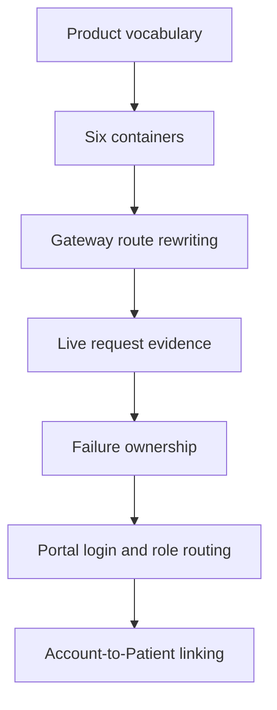
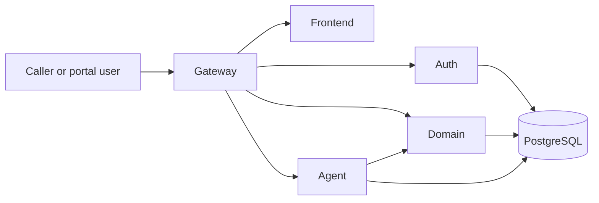

# Voice Agent — Codebase Orientation From First Principles

This guide assumes no prior knowledge of the repository. It preserves Lessons 1–7 of the codebase walkthrough: first learn the product's language, then locate the six runtime containers, trace a public request, interpret live evidence and failures, follow portal login from React to a signed JWT, and connect that portal account to a clinic Patient record.

## Learning path

## How to study this guide

1. Read the definition aloud.
2. Explain the problem the concept solves.
3. Follow the mechanism one step at a time.
4. Predict the example's result before running it.
5. Run it, change one meaningful input or line, and explain why the result changed.
6. Answer the checkpoint without looking at the answers.

Local sources: `CONTEXT.md`, `README.md`, `docs/SPEC.md`, `docker-compose.yml`, `gateway/nginx.conf`, `gateway/proxy_common.conf`, `frontend/src`, `services/auth/app`, and `services/domain/app`.

---

# Module 1 — Product and runtime orientation

### Visual model — From a person to durable clinic state

**How to read it:** Begin with the person on the left. The Gateway is the public HTTP entrance and selects a destination. Auth owns portal accounts, Domain owns clinic facts and rules, Agent owns Maya's conversation, and PostgreSQL stores state that must survive process restarts.
