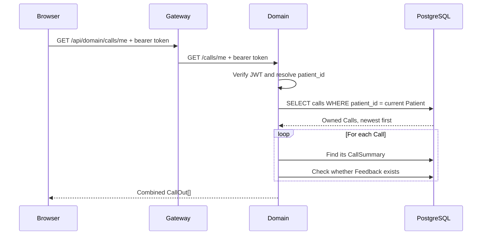

# Lesson 8 — Call History and Feedback

## 8. Call history and Feedback

**Definition:** Call history is the Patient-facing record of conversations with Maya. Each item combines the Call lifecycle, an optional AI-written summary, and whether the Patient has already submitted Feedback.

The main lesson is that the browser does not decide which calls belong to the Patient. Domain derives the Patient identity from the signed token and selects only Calls whose `patient_id` matches it.

## The three records behind one history card

One card in the UI may use three PostgreSQL records:

| Record | What it owns | Important fields |
| --- | --- | --- |
| `Call` | The conversation lifecycle | transport, caller phone, start/end time, transcript, Patient ID |
| `CallSummary` | The interpreted digest | summary, intent, sentiment |
| `Feedback` | The Patient's evaluation | stars, optional comment |

This separation matters. A Call exists as soon as a conversation starts, but its summary may not exist until the call ends and the Agent writes one. Feedback comes later and is written by the Patient.

```text
Call 42
├── patient_id: 7
├── ended_at: 2026-08-18 14:10
├── CallSummary: "Booked a follow-up visit"
└── Feedback: absent

What the portal receives:
{
  "id": 42,
  "summary": "Booked a follow-up visit",
  "intent": "booking",
  "sentiment": "positive",
  "has_feedback": false
}
```

## Read path: loading the Patient's calls



Follow the exact code:

1. `CallHistory.tsx` calls `api.get("/domain/calls/me")`.
2. The API helper adds the public `/api` prefix and the bearer token.
3. Gateway rewrites `/api/domain/calls/me` to Domain's `/calls/me` route.
4. `require_patient_identity` verifies the token and requires a linked Patient identity.
5. Domain filters with `Call.patient_id == principal.patient_id` and orders newest first.
6. For each Call, Domain looks up its optional summary and checks whether Feedback exists.
7. `_call_out` converts those records into the shape React needs.

The browser never sends a `patient_id` in this request. That prevents a request such as `/calls?patient_id=someone_else` from becoming an authorization hole.

## Why can the summary be missing?

`CallOut.summary`, `intent`, and `sentiment` are optional. This represents real timing:

```text
Call begins         Call ends          Summary is written
    │                   │                     │
    ├── Call exists ────┼─────────────────────┤
    ├── ended_at null ──┤                     │
    └── summary null ─────────────────────────┤
```

Before the summary exists, the UI says **“Summary not written yet.”** If `ended_at` is also missing, it marks the Call **“in progress.”** Missing summary data is therefore a supported state, not necessarily an error.

## Write path: leaving Feedback

The Feedback form sends:

```json
{
  "call_id": 42,
  "stars": 5,
  "comment": "Very quick."
}
```

Domain then checks the request in this order:

```text
valid token and Patient identity?
            │
            ▼
does Call 42 exist? ── no ──> 404
            │ yes
            ▼
does it have a Patient? ── no ──> 403
            │ yes
            ▼
does this Patient own it? ── no ──> 403
            │ yes
            ▼
does Feedback already exist? ── yes ──> 409
            │ no
            ▼
insert Feedback ──> 201
```

After a successful insert, React calls `load()` again. The next history response has `has_feedback: true`, so the form disappears and the thank-you message appears.

## UI rules are not security rules

React shows the form only when:

```tsx
call.ended_at && !call.has_feedback
```

That is useful presentation logic, but a user can bypass React and send HTTP requests directly. Security therefore remains in Domain:

- `require_patient_identity` blocks an unlinked account.
- `owns_or_admin` blocks Feedback on someone else's Call.
- The duplicate check returns `409` if Feedback already exists.
- `Feedback.call_id` is also unique in PostgreSQL.

The last two checks deliberately overlap. The application check gives a clear error, while the database uniqueness constraint remains the final defense if two submissions race each other.

## Status codes you should be able to predict

| Situation | Result | First rejecting mechanism |
| --- | ---: | --- |
| Missing, expired, or invalid bearer token | `401` | JWT authentication |
| Valid Patient account that is not linked | `403` | `require_patient_identity` |
| Unknown `call_id` | `404` | Domain lookup |
| Call belongs to another Patient | `403` | `owns_or_admin` |
| Feedback already exists | `409` | Domain conflict check |
| Stars are outside 1–5 | `422` | Pydantic request validation |
| Valid first Feedback submission | `201` | Feedback inserted |

## Predict, then run

This small model mirrors the important Domain decisions:

```python
def feedback_status(call_patient_id, principal_patient_id, already_exists):
    if call_patient_id is None or call_patient_id != principal_patient_id:
        return 403
    if already_exists:
        return 409
    return 201


assert feedback_status(7, 7, False) == 201
assert feedback_status(7, 7, True) == 409
assert feedback_status(7, 8, False) == 403
```

Before running it, explain why changing `principal_patient_id` from `7` to `8` matters more than changing anything displayed in React.

## Current implementation detail

`GET /calls/me` runs one query for the Calls, then two more queries per Call: one for its summary and one for Feedback. This is an **N+1 query pattern**. It is easy to understand and acceptable for a small demo, but a larger history could be loaded more efficiently with joins or eager loading.

That performance issue does not change ownership: Domain should still build and authorize the Patient's history response.

## Source trail

- `frontend/src/pages/CallHistory.tsx` — loads history, displays optional summaries, and submits Feedback.
- `services/domain/app/routers/calls.py` — filters owned Calls, combines response records, and enforces Feedback rules.
- `services/domain/app/auth.py` — resolves the trusted Patient identity and checks ownership.
- `services/domain/app/models.py` — defines Call, CallSummary, and Feedback persistence.
- `services/domain/app/schemas.py` — validates the response shape and the 1–5 star range.
- `scripts/smoke_test.py` — proves successful history, successful Feedback, duplicate rejection, and cross-Patient rejection.

## Readiness checkpoint

Answer without looking back:

1. Why does `/calls/me` not accept a `patient_id` from React?
2. Why can a Call exist without a CallSummary?
3. What changes in the database after the first Feedback submission?
4. Why are both the Domain duplicate check and the database unique constraint useful?
5. Which layer returns `422` for `stars: 6`?

**Next:** Lesson 9 — Patient identity security: how one authorization model supports both portal accounts and verified voice sessions.
