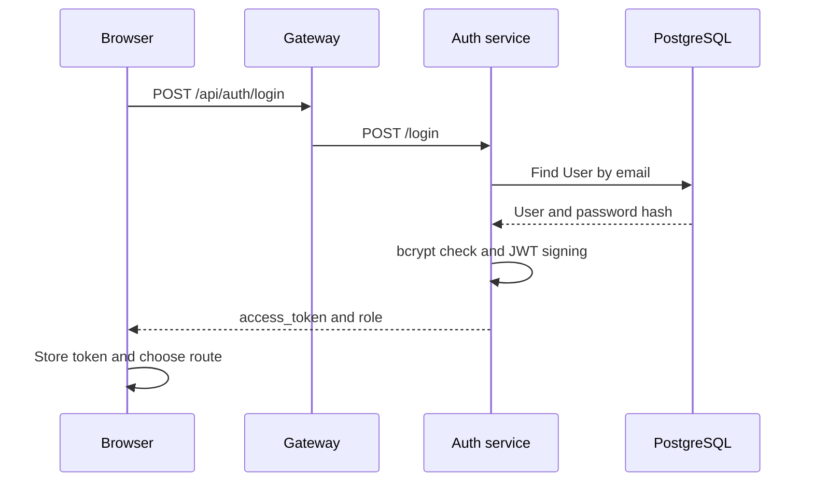

# Module 2 — Portal Authentication

### Visual model — Credentials become an authenticated browser session

**How to read it:** Begin with the credentials in the Browser. Gateway changes only the route, Auth verifies the account and signs the identity claim, and the Browser stores the result. A successful login reads the database but does not modify it.
