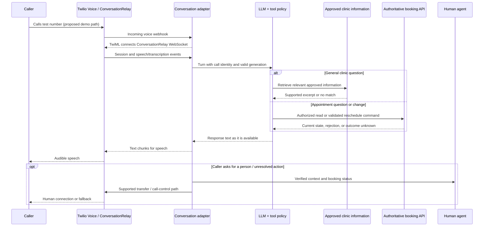

# Project story: a Twilio Voice AI appointment-agent demo

> **Purpose and status.** This is a demo/MVP learning project for understanding how a Twilio Voice AI application works end to end. The existing Maya repository uses synthetic clinic data and an ElevenLabs voice shell; its Twilio ConversationRelay phone path was deferred and remains a proposed extension. The business case and senior-engineer responsibilities below describe how to reason about a production-style version. They are not claims that this demo served a real customer or that Sean built Twilio's platform.

**Professional story update, October 19, 2026:** The [Twilio employment story](https://github.com/SeanYHan888/beacon-fire/blob/main/reusme_building/career_timeline/05a_2025-06_to_2026-08_twilio/TWILIO_REVIEW_DRAFT.md) now includes Sean's confirmed outcome that correlated session, tool, and transfer events helped engineers identify the cause of failed handoffs. Use that account for the resume and professional interview. The mock-clinic scenarios and proposed measures in this learning story remain educational material; the employment outcome does not establish a result from this demo.

## Code-grounded incident practice

The [incident walkthrough and verification record](https://github.com/SeanYHan888/beacon-fire/blob/main/reusme_building/output/source/incident_walkthroughs_2026-10-19.md) traces the existing demo's conversation-identity failure class and connects it to the professional story's session-control concerns. Its source anchors distinguish current code from the proposed phone adapter.

In the existing ElevenLabs adapter, an unexpanded session placeholder can be ignored in favor of a usable conversation ID. Stable identity lets a Caller complete Verification on a later turn under the same server-side state. In-process session locking prevents two turns from overlapping model execution or opening two Call records, and checkpointed identity supports restoration when the in-memory session is lost.

On October 19, 92 selected offline tests passed across identity/lifecycle, the voice adapter, graph/tools, and tool contracts. They use a scripted model and fake domain service. They do not prove real phone-transfer completion, multi-replica locking, or a completed late-speech controller. When all usable IDs are missing, the current adapter still warns and creates a fresh session. The inspected HTTP client also does not explicitly propagate the incoming request ID across the agent-to-domain request, so middleware alone does not establish a continuous cross-service trace.

The walkthrough's late-tool-result/human-escalation timeline is a design rehearsal based on the professional story's confirmed failure class. Building and testing its full phone controller remains part of the proposed roadmap.

## What Twilio Voice AI is

Twilio describes Voice AI as a way to handle common calls with an AI agent and route complex requests to people. Its [Voice AI overview](https://www.twilio.com/en-us/use-cases/voice-AI) names Programmable Voice, ConversationRelay, Media Streams, speech recognition, and text-to-speech as building blocks. In the proposed Twilio version of this demo, **ConversationRelay** is the real-time speech interface: Twilio manages the call and speech interaction while the demo application owns conversation policy, the LLM, tools, booking decisions, and escalation. See [ConversationRelay documentation](https://www.twilio.com/docs/voice/conversationrelay) for the product boundary.

## Business setting and opportunity

The demo uses a **mock clinic** to make a common business problem concrete: callers want to find times, reschedule appointments, ask routine questions, or reach a person. In a real appointment operation, routine calls can consume staff time and after-hours callers may give up. A wrong appointment or an uncertain answer after a timeout can create repeat calls and loss of trust. Those are the business reasons to evaluate voice AI; this repository has not measured a real organization's results.

The demo's users are fictional callers and staff. Its target Twilio flow is **answer routine clinic questions, handle related follow-ups, read availability, verify the caller, request a reschedule, confirm the authoritative outcome, and transfer to a human**. Payments and high-risk account changes are outside this exercise. The LLM may suggest an action, but only the scheduling service may commit one.

### Business goals and guardrails

| Goal | How we would measure it | Failure guardrail |
|---|---|---|
| Resolve routine requests | Correctly completed requests / eligible requests | Verify booking state, not merely a friendly answer |
| Protect agent capacity | Agent minutes per correctly completed request | Track repeat calls and transfers caused by failure |
| Respect caller time | Time to first audible response; total call time | No long silence during slow tools; offer a human |
| Keep changes trustworthy | Duplicate or incorrect booking changes per request | Hold ambiguous results for reconciliation |
| Make transfers useful | Transfer reason, verified identity, last confirmed booking state | No unsupported “done” claim to caller or agent |
| Keep answers relevant and safe | Unsupported-claim rate, off-topic responses, privacy incidents, caller corrections | Ground factual answers and release only approved speech |
| Control unit economics | Voice + speech + model + tool + agent cost per correct outcome | Review cost with quality, not deflection alone |

These are **possible measures for a real deployment**, with no claimed baseline or improvement number. In the demo, we can measure synthetic call correctness, failure handling, latency, and cost. A real pilot would also compare eligible call types with the existing human path and review privacy and accessibility concerns before expansion.

## What a senior software engineer would do on a production version

A senior engineer on the **application team** would lead the design across telephony integration, conversation orchestration, and scheduling. They would define the ConversationRelay adapter and per-call state model, agree on booking API contracts, set timeout and reconciliation rules, review privacy/security boundaries, and make failure cases testable. They would work with support operations on escalation and the agent view, and with product/finance on correct resolutions and cost.

In this demo, you can practice those application-side decisions with Maya's synthetic scheduling core. **Twilio owns ConversationRelay itself**; the demo uses its documented interface. Building or studying this adapter would not mean you built Twilio's speech service or call platform.

The key judgment is to treat **speech, conversation, and business transaction state as separate**. A caller can interrupt speech while a reschedule keeps running; the AI can generate words that were never played; a tool can time out locally after the scheduling service committed the change. An application that collapses these into one “turn completed” flag will give incorrect answers.

## Design and call flow

The exact TwiML, message fields, and handoff control must follow Twilio's current [ConversationRelay](https://www.twilio.com/docs/voice/conversationrelay) and [WebSocket message](https://www.twilio.com/docs/voice/conversationrelay/websocket-messages) contracts. The diagram is the **proposed application design**, not evidence that this repo already takes phone calls.

## When a caller asks a related question

The AI should first decide **what kind of answer the question needs**, using the current call context without assuming that a previous answer is still current. A public clinic question such as hours, parking, location, or what to bring goes to the approved FAQ lookup; it does not require caller verification. An availability question goes to the live slot read. A question about *the caller's own* appointment requires verification and a fresh appointment read. A request to change an appointment becomes a validated command. The model uses the returned facts to phrase a short answer; it is not the source of those facts.

The demo already has this pattern in [`lookup_clinic_info`](../../services/agent/app/tools.py), [`find_appointment_times`](../../services/agent/app/tools.py), [`list_my_appointments`](../../services/agent/app/tools.py), the [FAQ search](../../services/domain/app/faq.py), and the [conversation prompt](../../services/agent/app/prompts.py). Its FAQ search can return no result when no sufficiently relevant entry is found. The proposed Twilio adapter would carry the caller's transcribed question into the same agent workflow and send only the approved answer back as speech.

| Caller asks | What the agent checks | Example spoken response in the **synthetic demo** |
|---|---|---|
| “Do you have parking?” | Approved FAQ entry on parking | “Yes, there's free parking in the attached garage. Bring your ticket for validation.” |
| “Is it free?” after the parking answer | Prior turn resolves “it” to parking; confirm against the same approved FAQ fact | “Yes, parking is free.” |
| “What time is my appointment?” | Verify the caller, then read their current appointment | “I can check that after I verify who I'm speaking with.” After verification, speak the time returned by the scheduling service. |
| “Do you have a rooftop helipad?” | FAQ has no reliable answer | “I don't have information about that. I can connect you with the staff.” |
| “What does my test result mean?” | Out-of-scope/sensitive request | “I can't interpret results. I can connect you with the clinical team.” |

For a related follow-up, conversation history supplies the referent (“it” means parking), but the agent still follows the same source and permission rules. It should not repeat the whole prior answer, invent a policy, or expose another caller's record. If speech recognition is unclear, ask one short clarifying question before using a tool. For a factual answer with no reliable source, say so and offer a human. For an appointment status, check the authoritative system again rather than relying on a previous model message, because staff or another channel may have changed it during the call. The mock FAQ wording above comes from [`seed.py`](../../services/domain/app/seed.py); it is not a real clinic policy.

## Three design decisions worth defending

1. **ConversationRelay for the proposed Twilio path.** Twilio handles speech recognition, speech synthesis, and pacing so the exercise can focus on booking correctness and transfer. Media Streams would give raw audio control, but also require ownership of audio transport, STT/TTS choices, turn-taking, and more latency/failure surfaces. Revisit if custom audio processing becomes a requirement.
2. **The booking service is authoritative.** An LLM tool request is an intention. The server checks caller identity, appointment ownership, slot availability, policy, and a stable operation ID. It returns an outcome only after the booking system confirms it. A network timeout means **unknown**, not “failed.”
3. **Human handoff carries transaction state.** Once a transfer starts, stale AI text is suppressed. The agent sees the caller's verified identity, reason, last audible confirmation, and reschedule status: confirmed, rejected, pending approval, or unknown/reconciling. The caller hears a truthful status and transfer announcement, not an invented success.

## Error handling the caller can understand

The proposed application would classify errors by **whether the business action could have happened**. That distinction drives both recovery and the spoken message. Every fallback should be short, say only what is known, and offer the next useful action. The conversation controller would record a redacted error category and correlation IDs so operators can find the cause without putting raw secrets or a full transcript in ordinary logs.

| Failure | Application action | What the caller hears |
|---|---|---|
| Speech is unclear or incomplete | Wait for a final prompt; ask for one fact again rather than guessing an appointment or calling a tool. | “I didn't catch the date. Could you say it again?” |
| LLM is slow, unavailable, or produces unusable output | Enforce a deadline; stop that generation; use a deterministic fallback or transfer. Keep the current booking operation separate. | “I'm having trouble answering right now. I can connect you with someone.” |
| FAQ lookup has no relevant approved source | Do not fill the gap from model memory; offer a human or a narrower question. | “I don't have a reliable answer to that. I can connect you with the team.” |
| Booking service rejects a request | Preserve the specific authoritative reason, such as a slot conflict or required approval; offer an allowed alternative. | “That time is no longer available. Would you like another?” |
| Booking request times out | Mark the outcome `unknown`, retain the operation ID, reconcile with booking authority, and prevent a fresh duplicate request. | “I'm checking whether that change went through. I won't submit it again yet.” |
| WebSocket or application fails | End transient tasks, retain durable command state, and use the tested call fallback if the call is still routable. Twilio does not automatically reconnect a lost ConversationRelay socket. | A brief service apology or human route where the call remains active; never a fabricated success. |
| Human route is unavailable | Record the failed transfer, use an approved queue/callback path, and retain the unresolved booking status. | “I can't connect you right now. I can arrange a callback and pass along what we've verified.” |

The exact WebSocket failure path must be tested against the chosen Twilio configuration. [Twilio's ConversationRelay message documentation](https://www.twilio.com/docs/voice/conversationrelay/websocket-messages) describes the lack of automatic reconnect; the booking and fallback actions above are proposed application behavior.

## Preventing unnecessary or unsupported AI answers

The proposed Twilio voice agent would have a **small allowed scope**: answer approved service facts, read availability, help with a verified booking request, and transfer. It should answer the caller's actual question in one or two spoken sentences, offer at most a few choices, and ask one clear follow-up only when needed. It should not narrate its reasoning, repeat a long policy, volunteer unrelated information, reveal internal IDs, or disclose another customer's data. A request outside scope gets a brief boundary and a useful route to a person; a caller asking for a person is transferred without a sales pitch or extra questions.

The proposed production-style design would enforce this at several layers: an input scope and injection check; retrieval only from approved current service content; server-side tool authorization and booking rules; and a response contract that allows confirmation only from an authoritative result. Prompt instructions help with tone and brevity but are not the security or transaction boundary. [Twilio recommends early streaming](https://www.twilio.com/docs/voice/conversationrelay/best-practices) for lower latency, while noting that buffering may improve pacing. An output check after Twilio has spoken cannot retract an unsupported claim. For this demo, buffering and checking a short clause before sending it is one option to test for factual answers; the added delay should be measured. High-risk statements such as “your appointment is moved” should be populated from a confirmed booking result before any speech is sent. The broader evidence and tradeoffs are in the [production voice AI research](industry-practice-research.md).

The existing Maya project already contains short-answer prompt guidance, input/output guards, and server-owned scheduling policy in [`prompts.py`](../../services/agent/app/prompts.py), [`guardrails.py`](../../services/agent/app/guardrails.py), and [`scheduling.py`](../../services/domain/app/routers/scheduling.py). Those are reusable lessons, not proof that the proposed ConversationRelay streaming gate or all error paths already exist.

## The difficult incident in the story

A caller asks to move a visit, then interrupts the AI to ask for an agent. The reschedule request has timed out at our service. A late success response arrives while the transfer is starting. The app stops the old speech and generation, but does not assume the business action was canceled. It reconciles the same logical operation with the authoritative booking service and updates the handoff record. The caller hears a short, truthful transfer message; once handoff starts, the bot does not resume to announce a late result. The agent sees the operation ID, the verified final state if known, or a clear “outcome unknown” marker, and gives the caller the final answer after checking current booking state. The human does not repeat the mutation merely because the original request timed out.

This scenario connects caller experience to concurrency and transaction semantics. The exact order of sounds and UI updates belongs in a tested state machine, not just a prompt.

## Delivery and senior-level collaboration

For this MVP, build in stages: a local protocol replay harness, then a test number with synthetic bookings and human-handoff simulation. Contract tests should cover the webhook and socket messages; fault injection should cover interruption, disconnect, duplicate delivery, and tool timeouts. A real deployment would then need product/support approval for spoken fallback language, security review of identity and transcript handling, an operator runbook, and a limited pilot before broader routing.

In an interview, describe this as a **demo/MVP used to learn Twilio Voice AI architecture**. For pieces not yet implemented, say “I designed how I would extend Maya with ConversationRelay.” After building and testing a piece, describe exactly what you implemented and measured in the demo. Do not turn synthetic outcomes into production metrics or imply that the demo proves a senior title or ownership of Twilio's platform.
